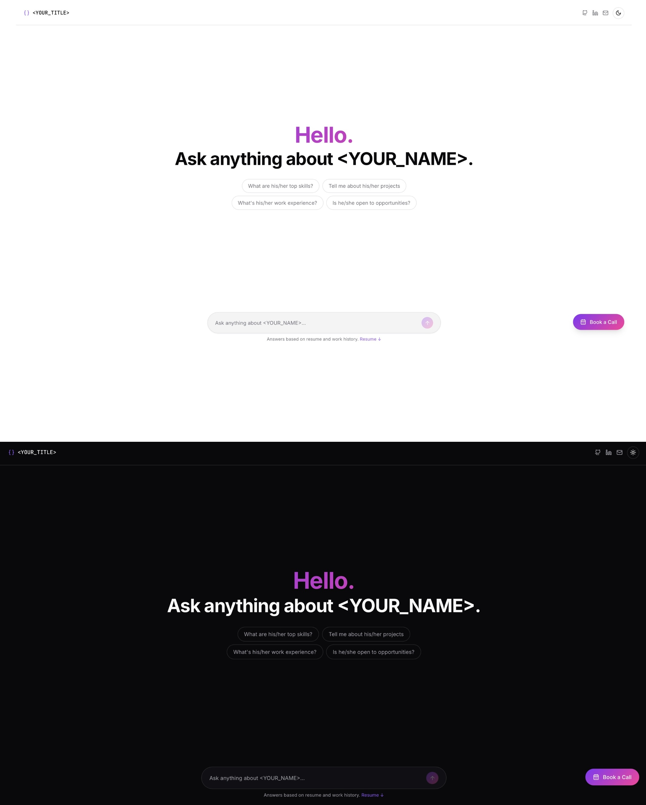

# AI Portfolio Chatbot

> A RAG-powered chatbot that lets recruiters ask anything about you — your skills, projects, and experience — and get instant, streaming answers. Fork it, drop in your own data, and ship your own interactive AI portfolio.


---

## Demo



---

## How It Works

```
Recruiter types a question
        │
        ▼
┌─────────────────────────┐
│   Next.js Edge Route    │  ← Guardrails: blocks injection,
│   /api/chat             │    toxicity & PII before anything reaches the LLM
└────────────┬────────────┘
             │ clean request
             ▼
┌─────────────────────────┐
│   FastAPI Backend       │
│   /chat                 │
│                         │
│  1. Embed the query     │  ← HuggingFace (all-MiniLM-L6-v2, 384 dims)
│  2. Vector search       │  ← Supabase pgvector (cosine similarity, top 8)
│  3. Build RAG prompt    │
│  4. Stream LLM response │  ← Groq (LLaMA 4 Scout)
└────────────┬────────────┘
             │ streaming tokens
             ▼
    Chat UI renders with
    typewriter animation
```

---

## Features

- **Streaming responses** — tokens stream in real time, no waiting for full generation
- **Typewriter reveal** — AI replies animate character-by-character after streaming completes
- **RAG pipeline** — answers are grounded in your actual resume data, not hallucinated
- **Guardrails** — prompt injection, toxicity, and PII checks on every request (edge runtime)
- **Session persistence** — chat history survives page refreshes via `sessionStorage`
- **Suggestion chips** — pre-built questions on the landing screen to guide recruiters
- **Book a Call CTA** — floating button linked to your calendar (Cal.com or any URL)
- **Dark / light theme** — system preference by default, togglable in the navbar
- **Fully responsive** — works on mobile, tablet, and desktop

---

## Tech Stack

| Layer | Technology |
|---|---|
| Frontend framework | Next.js 16 (App Router, React 19) |
| Styling | Tailwind CSS, shadcn/ui (Radix primitives) |
| Animations | Framer Motion |
| AI SDK | Vercel AI SDK (`ai` v6, `@ai-sdk/react` v3) |
| Markdown rendering | `react-markdown` + `remark-gfm` |
| Guardrails | `@llm-guardrails/core` (injection, toxicity, PII) |
| Theming | `next-themes` |
| Backend framework | FastAPI + Uvicorn |
| LLM provider | Groq (`meta-llama/llama-4-scout-17b-16e-instruct`) |
| Embeddings | HuggingFace Endpoints (`all-MiniLM-L6-v2`, 384 dims) |
| RAG orchestration | LangChain (`MarkdownHeaderTextSplitter`) |
| Vector database | Supabase (PostgreSQL + pgvector) |

---

## Prerequisites

Make sure you have these installed and accounts created before starting:

- **Node.js** ≥ 18 and **npm** ≥ 9
- **Python** ≥ 3.11
- A **[Supabase](https://supabase.com)** account (free tier is enough)
- A **[Groq](https://console.groq.com)** API key (free tier available)
- A **[Hugging Face](https://huggingface.co)** account with an API token (free)

---

## Quick Start

> **First time?** Complete the [one-time setup](#getting-started) below first (Supabase, env files, data ingestion). Once that's done, use these scripts every time you want to run the project locally.

### Mac / Linux

```bash
./run.sh
```

### Windows

Double-click `run.bat`, or run it from Command Prompt:

```bat
run.bat
```

Both scripts will:
1. Check that your `.env` files exist (and exit with a clear message if they don't)
2. Create the Python virtual environment on first run
3. Install backend and frontend dependencies automatically (skipped on subsequent runs)
4. Start the FastAPI backend on `http://localhost:8000`
5. Start the Next.js dev server on `http://localhost:3000`
6. Open your browser automatically after a few seconds

Press **Ctrl+C** (Mac/Linux) to stop both servers at once. On Windows, close the two terminal windows that open.

---

## Getting Started

### 1. Fork & Clone

```bash
# Fork this repo on GitHub, then clone your fork
git clone https://github.com/Namangupta123/AI-protfolio.git
cd AI-protfolio
```

---

### 2. Set Up Supabase

1. Create a new project at [supabase.com](https://supabase.com).
2. In your project dashboard, open the **SQL Editor**.
3. Paste and run the entire contents of [`Backend/supabase_setup.sql`](Backend/supabase_setup.sql).

This creates:
- The `pgvector` extension
- A `documents` table (`id`, `content`, `embedding`)
- An IVFFlat index for fast cosine similarity search
- A `match_documents` RPC function used by the RAG query

> **Important:** Build the IVFFlat index *after* you ingest your data (Step 3) for best performance. You can re-run the index creation line from the SQL file at that point.

---

### 3. Set Up & Run the Backend

```bash
cd Backend

# Create and activate a virtual environment
python -m venv .venv
source .venv/bin/activate      # Windows: .venv\Scripts\activate

# Install dependencies
pip install -r requirements.txt

# Configure environment variables
cp .env.example .env
# Edit .env and fill in all values (see Environment Variables section below)
```

**Populate your knowledge base:**

Edit [`Backend/resume.md`](Backend/resume.md) (or whichever file `KNOWLEDGE_BASE_FILE` points to) with your resume, projects, skills, and anything else you want the AI to know about you. The more detail you add, the better the answers.

**Ingest your data into Supabase:**

```bash
python ingest.py
```

This splits your markdown file by headers, generates embeddings for each chunk, and stores them in Supabase. You only need to re-run this when your knowledge base changes.

**Start the API server:**

```bash
uvicorn main:app --reload --port 8000
```

The backend is now running at `http://localhost:8000`. You can verify it with:

```bash
curl http://localhost:8000/health
# → {"status":"ok"}
```

---

### 4. Set Up & Run the Frontend

```bash
cd Frontend

# Install dependencies
npm install

# Configure environment variables
cp .env.example .env.local
# Edit .env.local and fill in all values (see Environment Variables section below)

# Start the dev server
npm run dev
```

Open [http://localhost:3000](http://localhost:3000) — your portfolio chatbot is live.

---

## Environment Variables

### Backend (`Backend/.env`)

| Variable | Required | Description |
|---|---|---|
| `SUPABASE_URL` | Yes | Your Supabase project URL (`https://<id>.supabase.co`) |
| `SUPABASE_SERVICE_KEY` | Yes | Service role key from Supabase → Project Settings → API |
| `GROQ_API_KEY` | Yes | API key from [console.groq.com](https://console.groq.com) |
| `HUGGING_FACE_API_KEY` | Yes | Access token from [huggingface.co/settings/tokens](https://huggingface.co/settings/tokens) |
| `FRONTEND_URL` | No | Origin allowed by CORS. Defaults to `http://localhost:3000` |
| `KNOWLEDGE_BASE_FILE` | Yes | Path to your resume/knowledge base markdown file. |
| `SYSTEM_PROMPT_FILE` | YES | Path to the AI persona file. |
| `CUSTOM_SYSTEM_PROMPT` | No | Overrides the system prompt file entirely. Set this in your production environment to keep the prompt private without committing it to the repo. Template in `Backend/.env.example`. |

### Frontend (`Frontend/.env.local`)

| Variable | Required | Description |
|---|---|---|
| `BACKEND_URL` | Yes | URL of your running FastAPI backend (e.g. `http://localhost:8000`) |
| `NEXT_PUBLIC_NAME` | Yes | Your full name — displayed in the hero and input placeholder |
| `NEXT_PUBLIC_TITLE` | Yes | Your title or tagline — shown in the navbar |
| `NEXT_PUBLIC_GITHUB_URL` | Yes | Link to your GitHub profile |
| `NEXT_PUBLIC_LINKEDIN_URL` | Yes | Link to your LinkedIn profile |
| `NEXT_PUBLIC_MAIL_URL` | Yes | `mailto:` link for your email address |
| `NEXT_PUBLIC_RESUME_URL` | Yes | Direct link to your resume PDF (Google Drive, Dropbox, etc.) |
| `NEXT_PUBLIC_CAL_URL` | Yes | Your scheduling link (Cal.com, Calendly, etc.) |

---

## Populating Your Knowledge Base

The AI can only answer questions it has data for. The richer your knowledge base, the better the answers.

Edit the file at `Backend/resume.md` (or whatever `KNOWLEDGE_BASE_FILE` is set to). Structure it using markdown headers — the ingestion script splits by `#`, `##`, and `###` headings, keeping each section as a semantically whole chunk.

**Example structure:**

```markdown
# Your Name

## About
Final-year CS student at XYZ University. Backend engineer focused on...

## Skills
- Languages: Python, TypeScript, Go
- Frameworks: FastAPI, Next.js, Django
- Infrastructure: AWS, Supabase, Docker

## Work Experience

### Software Engineer Intern — Acme Corp (Jan 2024 – May 2024)
Built a real-time notification pipeline using Kafka and Redis...

## Projects

### Project Vanni
IEEE-published NLP research on voice-based language learning...

## Education
B.Tech Computer Science, XYZ University (2022–2026)

## Contact
Email: you@example.com
```

After editing, re-run `python ingest.py` to update Supabase with the new chunks.

> **Note:** If you're re-ingesting after a previous run, clear the `documents` table first to avoid duplicate chunks:
> ```sql
> TRUNCATE TABLE documents;
> ```

---

## Customizing the Frontend Design

All visual customization is concentrated in a handful of files. You don't need to touch any component logic to rebrand the UI.

### Identity & Links

All public-facing text and URLs live in `Frontend/.env.local`:

```bash
NEXT_PUBLIC_NAME=Jane Doe
NEXT_PUBLIC_TITLE=Full-Stack Engineer · Open to Work
NEXT_PUBLIC_GITHUB_URL=https://github.com/janedoe
NEXT_PUBLIC_LINKEDIN_URL=https://linkedin.com/in/janedoe
NEXT_PUBLIC_MAIL_URL=mailto:jane@example.com
NEXT_PUBLIC_RESUME_URL=https://drive.google.com/...
NEXT_PUBLIC_CAL_URL=https://cal.com/janedoe/30min
```

---

### Color Palette

All colors are defined as CSS custom properties in [`Frontend/src/app/globals.css`](Frontend/src/app/globals.css). The project uses HSL values so you can change a hue in one place and it cascades everywhere.

**Light mode (`:root` block):**

```css
:root {
  --background: 0 0% 100%;        /* page background */
  --foreground: 240 10% 4%;       /* primary text */
  --card: 240 5% 96%;             /* card / input surfaces */
  --muted-foreground: 240 4% 46%; /* secondary text, timestamps */
  --border: 240 6% 90%;           /* borders, dividers */
  --primary: 262 83% 58%;         /* primary accent (violet) */
  --ring: 262 83% 58%;            /* focus ring */
}
```

**Dark mode (`.dark` block):**

```css
.dark {
  --background: 240 10% 4%;
  --foreground: 0 0% 98%;
  --card: 240 10% 7%;
  --muted-foreground: 240 5% 65%;
  --border: 240 4% 16%;
  --primary: 263 70% 70%;
  --ring: 263 70% 70%;
}
```

Change the HSL values to match your brand. For example, to switch the accent from violet to sky blue, change `262 83% 58%` to `199 89% 48%`.

---

### Gradient Accent

The gradient is used for the hero text, the send button, chat bubbles (user messages), and the "Book a Call" button. It is defined in two utility classes in `globals.css`:

```css
.gradient-text {
  background: linear-gradient(135deg, #7C3AED 0%, #EC4899 100%);
  /* violet → pink */
}

.gradient-bg {
  background: linear-gradient(135deg, #7C3AED 0%, #EC4899 100%);
}
```

Replace the hex values with your own colors. The angle (`135deg`) and stop positions (`0%`, `100%`) can also be adjusted. Example — an ocean gradient:

```css
.gradient-text {
  background: linear-gradient(135deg, #0EA5E9 0%, #6366F1 100%);
}
.gradient-bg {
  background: linear-gradient(135deg, #0EA5E9 0%, #6366F1 100%);
}
```

---

### Fonts

Fonts are loaded from Google Fonts in [`Frontend/src/app/layout.tsx`](Frontend/src/app/layout.tsx):

```ts
import { Inter, JetBrains_Mono } from "next/font/google";

const inter = Inter({ subsets: ["latin"], variable: "--font-inter" });
const jetbrainsMono = JetBrains_Mono({ subsets: ["latin"], variable: "--font-mono" });
```

To change the fonts:
1. Pick a font from [fonts.google.com](https://fonts.google.com).
2. Import it from `"next/font/google"` (e.g. `import { Geist } from "next/font/google"`).
3. Replace the variable assignment. The CSS variable names (`--font-inter`, `--font-mono`) are referenced in `tailwind.config.ts`, so either update those too or keep the variable names as-is.

---

### Suggestion Chips

The pre-filled question buttons on the landing screen are defined in [`Frontend/src/app/page.tsx`](Frontend/src/app/page.tsx):

```ts
const SUGGESTION_CHIPS = [
  "What are his top skills?",
  "Tell me about his projects",
  "What's his work experience?",
  "Is he open to opportunities?",
];
```

Replace these with questions that fit your own profile and use the correct pronouns.

---

### AI Persona & Tone

The AI's personality lives in [`Backend/data/system_prompt.txt`](Backend/data/system_prompt.txt) — a plain text file completely separate from the Python code. Edit it and the next message sent to the API will use the new personality automatically, no server restart needed.

**Start by replacing the placeholders** at the top of the file with your own details:

| Placeholder | Replace with |
|---|---|
| `[FIRST_NAME]` | Your first name |
| `[LAST_NAME]` | Your last name |
| `[EMAIL_ADDRESS]` | Your contact email |
| `[PROJECT_1]`, `[PROJECT_2]` | Names of your notable projects |
| `[KEY_TECH_1]`, `[KEY_TECH_2]` | Your primary tech stack |
| `[UNIVERSITY/COMPANY]`, `[MAJOR_PROJECT]` | Your background details |

Key behaviors to customize beyond the placeholders:
- **Tone and style** — adjust the opening instructions about vocabulary and formality
- **Pronouns** — update "he/him" to your preferred pronouns throughout the file
- **Escalation** — update the CTA wording and make sure `[EMAIL_ADDRESS]` is set
- **Topics to deflect** — define what the AI should and shouldn't discuss

> **Production privacy:** If you don't want the system prompt committed to your public repo, set the `CUSTOM_SYSTEM_PROMPT` environment variable in your production environment instead. When this variable is set, it fully overrides the file and no file read occurs. The full list of backend env vars (including `CUSTOM_SYSTEM_PROMPT`) is in [`Backend/.env.example`](Backend/.env.example).

If you ever want to store the file somewhere else, point `SYSTEM_PROMPT_FILE` in `Backend/.env` to the new path (relative to the `Backend/` directory). If the file is missing at startup, the backend falls back to a generic `"You are a helpful AI assistant."` default and logs a warning.

---

### Switching the LLM Model

The model is set in `Backend/main.py`:

```python
model="meta-llama/llama-4-scout-17b-16e-instruct"
```

Groq supports multiple models. See the full list at [console.groq.com/docs/models](https://console.groq.com/docs/models). Faster models reduce latency; larger models improve reasoning quality.

---

## Deployment

### Frontend → Vercel

1. Push your fork to GitHub.
2. Import the repo at [vercel.com/new](https://vercel.com/new).
3. Set the **Root Directory** to `Frontend`.
4. Add all `NEXT_PUBLIC_*` variables and `BACKEND_URL` in the Vercel Environment Variables UI.
5. Deploy.

### Backend → Railway

1. Go to [railway.app](https://railway.app) and create a new project.
2. Connect your GitHub repo and set the **Root Directory** to `Backend`.
3. Set the **Start Command** to:
   ```
   uvicorn main:app --host 0.0.0.0 --port $PORT
   ```
4. Add all backend environment variables in the Railway Variables panel.
5. Deploy. Railway will give you a public URL — set this as `BACKEND_URL` in your Vercel project and redeploy.

> **CORS:** After deploying the frontend, update `FRONTEND_URL` in your Railway backend variables to your Vercel production URL (e.g. `https://your-portfolio.vercel.app`). Redeploy the backend.

---

## Project Structure

```
AI_Resume/
│
├── Backend/
│   ├── data/
│   │   └── system_prompt.txt    # ← YOUR PERSONA: edit to change the AI's tone & identity
│   ├── .env.example         # template for backend env vars
│   ├── config.py            # loads and validates env vars
│   ├── database.py          # Supabase client — insert & vector search
│   ├── embeddings.py        # HuggingFace endpoint embeddings singleton
│   ├── ingest.py            # one-shot script to populate Supabase
│   ├── main.py              # FastAPI app — /chat streaming endpoint
│   ├── requirements.txt     # Python dependencies
│   ├── resume.md            # ← YOUR DATA: edit this with your resume content
│   └── supabase_setup.sql   # run once in Supabase SQL Editor to initialize the DB
│
└── Frontend/
    ├── .env.example         # template for frontend env vars
    ├── tailwind.config.ts   # Tailwind theme (colors map to CSS vars)
    ├── package.json
    └── src/
        ├── app/
        │   ├── api/
        │   │   └── chat/
        │   │       └── route.ts   # edge API route — guardrails + proxy to FastAPI
        │   ├── globals.css        # ← DESIGN: all CSS variables (colors, gradients, animations)
        │   ├── layout.tsx         # ← DESIGN: fonts, ThemeProvider
        │   └── page.tsx           # ← DESIGN: suggestion chips, hero text, chat layout
        └── components/
            ├── BookACallButton.tsx   # floating CTA (uses NEXT_PUBLIC_CAL_URL)
            ├── ThemeToggle.tsx       # light/dark toggle button
            └── chat/
                ├── BottomBar.tsx     # input field + resume link
                └── MessageList.tsx   # chat bubbles, typewriter effect, typing indicator
```

---

## License

MIT — fork freely, ship your own version.
